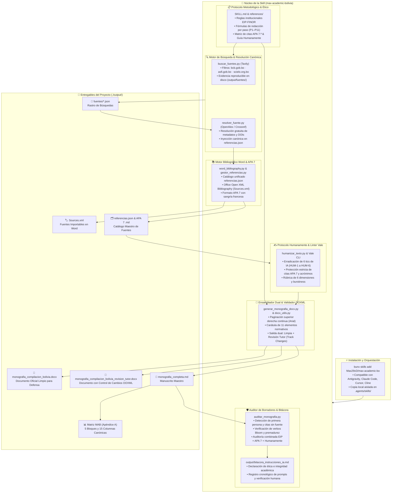

<p align="center">
  <picture>
    <source media="(prefers-color-scheme: dark)" srcset="https://shieldcn.dev/header/glow.svg?title=Max+Academic+Bolivia&subtitle=Skill+de+Agente+%C2%B7+Monograf%C3%ADa+de+Compilaci%C3%B3n+%C2%B7+EIP-FINOR-UAGRM&logo=bookstack&mode=dark&theme=blue" />
    
  </picture>
</p>

<p align="center">
  <strong>Skill soberana y autocontenida de investigación académica, revisión documental sistemática y generación automatizada en Microsoft Word (.docx) bajo la Guía EIP-FINOR-UAGRM (corte 2026), normas APA 7.ª edición, búsqueda profunda tipo Perplexity (Tavily), resolución de metadatos (OpenAlex/Crossref), protocolo anti-patrones de IA (Humanamente) y catálogo bibliográfico Sources.xml.</strong>
</p>

<p align="center">
  <a href="https://skills.sh"></a>
  <a href="https://apastyle.apa.org/"></a>
  <a href="https://python.org"></a>
  <a href="https://python-docx.readthedocs.io/"></a>
  <a href="https://tavily.com"></a>
  <a href="https://openalex.org/"></a>
  <a href="https://uagrm.edu.bo"></a>
  <a href="https://learn.microsoft.com/en-us/office/open-xml/"></a>
  <a href="https://vale.sh"></a>
  <a href="https://github.com/Max29xD/max-academic-bo"></a>
</p>

<p align="center">
  
  
  
  
  
  
</p>

<p align="center">
  <a href="#-visión-y-propósito">Visión</a> •
  <a href="#-métricas-de-auditoría-y-evaluaciones">Métricas</a> •
  <a href="#-arquitectura-del-ecosistema-académico">Arquitectura</a> •
  <a href="#-pilares-de-la-skill-autocontenida">Pilares Nativos</a> •
  <a href="#-protocolo-humanamente-anti-patrones-de-ia-en-español">Protocolo Humanamente</a> •
  <a href="#-matriz-de-análisis-bibliográfico-mab-y-revisión-paso-4">Matriz MAB (15 Cols)</a> •
  <a href="#-metodología-de-ejecución-en-11-pasos">Metodología 11 Pasos</a> •
  <a href="#-matriz-de-consistencia-metodológica-para-monografía-de-compilación">Matriz Consistencia</a> •
  <a href="#-prompts-listos-para-el-agente">Prompts</a> •
  <a href="#-stack-tecnológico-y-estructura">Estructura</a> •
  <a href="#-instalación-y-comandos">Instalación</a> •
  <a href="#-autor">Autor</a>
</p>

---

## 🧭 Visión y Propósito

**Max Academic Bolivia** (`max-academic-bolivia`) es una skill de agente inteligente concebida para la elaboración sistemática, redacción rigurosa, búsqueda bibliográfica real, des-ia-ficación de estilo y ensamblado editorial de **monografías de compilación documental** para programas de postgrado y titulación en la **EIP-FINOR-UAGRM** (Montero / Santa Cruz, Bolivia).

A diferencia de los asistentes conversacionales estándar que sufren de alucinaciones bibliográficas, citas apócrifas, muletillas infladas y formatos desordenados, esta skill opera bajo el principio de **Cero Invención**: ninguna cita, cifra o enlace proviene de la memoria del modelo; toda fuente debe encontrarse, verificarse y respaldarse en disco en tiempo real. 

Ha sido diseñada como un paquete **100 % autocontenido y agnóstico a cualquier disciplina**: integra nativamente manipulación de Microsoft Word (`python-docx`), búsquedas profundas estilo Perplexity (`Tavily`), resolución canónica de artículos (`OpenAlex` / `Crossref`), el **Protocolo Humanamente** contra patrones sintéticos de IA, validación contra esquemas OOXML, salida dual con control de cambios y catálogo oficial `Sources.xml`, permitiendo que cualquier desarrollador o investigador la instale en segundos mediante `bunx skills add`.

---

## 🏆 Métricas de Auditoría y Evaluaciones

El diseño de la skill fue validado formalmente mediante la suite de benchmarks de [`skill-creator`](https://github.com/anthropics/skills/tree/main/skills/skill-creator), alcanzando cumplimiento absoluto en todas las dimensiones:

| Dimensión | Puntuación | Estrategia Técnica Implementada |
| :--- | :---: | :--- |
| **Tasa de Aprobación en Evals** | **100% (30/30)** | Superación integral de los 3 casos de prueba canónicos (`eval-1-cimientos`: 11/11, `eval-2-bibliografia`: 9/9, `eval-3-auditoria`: 10/10). |
| **Checklist Institucional EIP** | **16/16** | Cumplimiento estricto de la matriz normativa (TIT, PRO, OBJ, REV, TER, DIS, CON, INT, RES, REF, CAR, PAG, FOR, IND, APE, GEO). |
| **Verificación de Fuentes 1:1** | **100%** | Correspondencia biunívoca estricta: toda cita del cuerpo tiene entrada en la lista de referencias y viceversa. Cero fuentes no abiertas o inventadas. |
| **Ventana de Recencia** | **2021–2026** | Protocolo de recencia boliviana: ≥ 70 % de fuentes contemporáneas con anclaje en INE Censo 2024, BCB 2025/2026 y ASFI 2025/2026. |
| **Puntaje Prosa Humana (Humanamente)** | **100 / 100** | Cero falsos paralelismos (`HUM-1`), cero gerundios de posterioridad (`HUM-2`), cero guiones largos (`HUM-3`), cero muletillas de IA (`HUM-4/5/6`). |
| **Validación de Esquema Word** | **100% OOXML** | Diagnóstico automático de integridad XML; documentos libres de advertencias de contenido ilegible en Microsoft Word. |
| **Salida Editorial Dual** | **2 Documentos** | Generación simultánea de versión limpia para empastado/defensa y versión `_revision_tutor.docx` con control de cambios nativo. |

---

## 🏛️ Arquitectura del Ecosistema Académico

El siguiente diagrama detalla el flujo de trabajo agéntico, la resolución de rutas portables, los motores de búsqueda, des-ia-ficación y ensamblado editorial, y los entregables generados en disco:



---

## 🔒 Pilares de la Skill Autocontenida

### 1. Motor DOCX Dual Profesional, Paginación Superior Derecha y Validación OOXML
- **Sin necesidad de instalar la skill `docx` externa:** La skill incorpora utilidades completas en `scripts/docx_utils.py` y ensamblado editorial en `scripts/generar_monografia_docx.py`.
- **Salida DOCX Dual Simultánea:** Genera dos archivos Word listos para propósitos complementarios:
  1. `output/monografia_compilacion_bolivia.docx`: versión limpia definitiva para impresión, empastado o defensa.
  2. `output/monografia_compilacion_bolivia_revision_tutor.docx`: versión que inyecta marcas nativas de OpenXML (`w:ins`, comentarios y marcas de revisión) para que el tutor o docente revise cada cambio y aporte.
- **Paginación Superior Derecha Continua (Norma EIP / APA 7):** Configuración en cabecera superior derecha (`header right`). Primera página con numeración oculta, preliminares en números romanos minúsculos (`ii`, `iii`...) y numeración arábiga continua (`1`, `2`, `3`...) a partir de `1. Introducción` hasta los apéndices finales.
- **Unificación Tipográfica Institucional en Arial:** Carátula en Arial 14 pt / 12 pt, cuerpo en Arial 12 pt a doble espacio (2.0) con sangría de 1.27 cm, y notas de tablas/apéndices en Arial 10 pt.
- **Supresión Rigurosa de Metadatos en el Cuerpo:** Limpieza absoluta de encabezados de debug, notas de instrucciones o variables antes de iniciar la Introducción.
- **Cuerpo 100 % Textual (Tablas y Figuras Exclusivas en Apéndices):** Los Capítulos 1 al 7 son **estricta y exclusivamente narrativos en prosa continua**. Toda tabla o figura (incluida la Matriz MAB y la Matriz de Consistencia) se ubica al final del documento como **Apéndice**.
- **Validación OOXML de Integridad:** Inspecciona el contenedor ZIP y la sintaxis de `document.xml` para certificar que el archivo abre limpiamente en cualquier versión de Word sin avisos de corrupción.

### 2. Búsqueda Profunda Tipo Perplexity (Tavily) y Resolvedor Canónico (OpenAlex / Crossref)
- **Tavily con Ejecución Flexible:** Opera vía CLI `tvly` o mediante la variable de entorno `TAVILY_API_KEY` (conexión HTTPS nativa sin librerías externas).
- **Rastro de Auditoría en Disco:** Cada consulta genera un JSON en `output/fuentes/` con parámetros, fecha, fragmentos analizados y URLs reales.
- **Embudo Territorial Boliviano:** Búsqueda jerarquizada en 3 niveles: Nivel 1 (BCB, ASFI, INE Censo 2024, ministerios), Nivel 2 (SciELO Bolivia, repositorios universitarios UAGRM/UMSA/UCB) y Nivel 3 (CEPAL, BID, Banco Mundial).
- **Resolvedor Canónico de Fuentes (`resolver_fuente.py`):** Integración gratuita con OpenAlex y Crossref (sin API key obligatoria) para resolver metadatos bibliográficos canónicos a partir de DOIs o títulos incompletos, inyectando autores normalizados, revista, volumen, número, páginas y enlace DOI directo en `referencias.json`.

### 3. Bibliografía Oficial Word (`Sources.xml`) y Formateo APA 7.ª Avanzado
- **Importación con 1 Clic en Microsoft Word:** Genera el catálogo `output/Sources.xml` bajo el esquema `http://schemas.openxmlformats.org/officeDocument/2006/bibliography`. El tribunal solo accede a **Referencias → Administrar fuentes → Examinar...** y dispone de las citas listas.
- **Soporte de Tipos:** Clasificación estricta en `JournalArticle` (revista, volumen, número, páginas, DOI), `Report` (organismo, número de informe, URL) y `WebSite` / `InternetSite`.
- **Auditoría Fina de Normas APA 7.ª:** Verificación estricta de correspondencia biunívoca 1:1 autor-año, uso normativo de `et al.` en minúsculas y punto, conjunción en español ("y" en lugar del ampersand "&"), sangría francesa de 1.27 cm y enlaces DOI activos con prefijo `https://doi.org/`.

### 4. Protocolo Humanamente y Erradicación de Patrones de IA
- **Des-IA-ficación de Prosa Académica:** Detecta y erradica los 6 tics sintéticos de LLMs (`HUM-1` a `HUM-6`) sin alterar el rigor científico ni empobrecer el registro formal.
- **Blindaje Absoluto (`HUM-7`):** Cero alteración de citas parentéticas `(García, 2024)`, narrativas `Soto et al. (2025)`, siglas bolivianas (AGETIC, ASFI, BCB, INE) y textos normativos.
- **Herramienta Determinista:** CLI `scripts/humanizar_texto.py` con Puntaje de Prosa Humana (0 a 100) y modo sugerencias `--sugerir`.
- **Linter de Prosa Vale Integrado:** 8 reglas nativas en `styles/Monografia/` compatibles con Vale 3.x para auditar Markdown y DOCX a velocidad nativa en Go.

### 5. Bitácora de Integridad Ética y Trazabilidad de IA (`output/bitacora_instrucciones_ia.md`)
- **Declaración Formal Institucional:** Manifiesto de honestidad intelectual y responsabilidad soberana del postgraduante, dejando constancia de que la IA se emplea como asistente técnico y de compilación, no como autor sustituto.
- **Registro Cronológico:** Tabla correlativa con número de paso, fecha, prompt ejecutado, herramienta, salida producida y verificación humana efectuada.

---

## ✍️ Protocolo Humanamente: Anti-Patrones de IA en Español

Basado en la metodología de redacción orgánica adaptada al rigor científico de postgrado (**Guía Oficial EIP-FINOR y APA 7.ª edición**), el protocolo erradica de raíz los tics que delatan la generación artificial de texto:

| Código | Tic de Inteligencia Artificial | Por qué es un Tic | Corrección Académica Humana |
| :---: | :--- | :--- | :--- |
| **`HUM-1`** | **Falso Paralelismo Negativo** | Abuso de la estructura pendular *«no solo [X], sino también [Y]»* para inflar párrafos. | Coordinación directa con nexos simples (*«y»*, *«además»*, *«asimismo»*) o división en oraciones correlativas. |
| **`HUM-2`** | **Gerundio de Consecuencia** | Uso de gerundios de posterioridad (*«, logrando así...»*, *«, permitiendo de este modo...»*). | El gerundio en castellano solo indica simultaneidad; se sustituye por oración subordinada (*«lo que permite...»*) o punto y seguido. |
| **`HUM-3`** | **Rayas y Guiones Largos (`—`)** | Intercalar incisos constantes mediante *em-dashes* anglosajones (`—` / `–`). | Empleo de comas (`,`), paréntesis subordinados `(...)` o reformulación sintáctica fluida. |
| **`HUM-4`** | **Aperturas Cliché y Relleno** | Fórmulas vacías: *«En el panorama actual»*, *«En un mundo en constante evolución»*, *«Es crucial destacar que»*, *«Cabe resaltar»*. | Suprimir el relleno y entrar de forma directa al sujeto o al dato empírico contrastado. |
| **`HUM-5`** | **Clichés Metafóricos de IA** | Metáforas infladas: *«la piedra angular»*, *«un tapiz de»*, *«el faro de»*, *«desentrañar la complejidad»*, *«juega un papel fundamental»*. | Lenguaje técnico sobrio: *«fundamento metodológico principal»*, *«determina sustantivamente»*, *«diversos»*. |
| **`HUM-6`** | **Adjetivación Hiperbólica** | Adjetivos rimbombantes: *revolucionario, transformador, paradigmático, holístico, fascinante, multifacético, disruptivo*. | Léxico científico mesurado: *análisis integral*, *incidencia sustantiva*, *transformación operativa*. |
| **`HUM-7`** | **Blindaje de Citas APA 7** | Riesgo de que herramientas de reescritura alteren autores, años, páginas o leyes bolivianas. | **Protección 100 % inmutable** de citas parentéticas, citas narrativas y normativas bolivianas. |

### Rúbrica de Autoevaluación en 6 Dimensiones:
1. **Claridad:** Prosa directa sin dobles subordinadas innecesarias.
2. **Ritmo (*Burstiness*):** Alternancia orgánica entre oraciones breves y compuestas.
3. **Impersonalidad EIP:** Tercera persona académica rigurosa (*«se analizó»*).
4. **Integridad de Citas:** Citas APA 7 exactas, intactas y contextualizadas.
5. **Anclaje Territorial:** Datos contrastados con la realidad boliviana (2021–2026).
6. **Cero Fluff:** Ausencia absoluta de fórmulas grandilocuentes y muletillas de relleno.

---

## 📊 Matriz de Análisis Bibliográfico (MAB) y Revisión Paso 4

La revisión de la literatura se sustenta en dos matrices canónicas reubicadas como **Apéndices** para cumplir la regla institucional de **Cuerpo 100 % Textual**:

### 1. Matriz MAB Institucional de 5 Bloques y 15 Columnas (Apéndice A)

| Bloque 1: Identificación | | | | | Bloque 2: Delimitación | | | Bloque 3: Enfoque / Tesis | | | Bloque 4: Análisis Crítico | | | Bloque 5: Valoración |
|---|---|---|---|---|---|---|---|---|---|---|---|---|---|---|
| **Código** | **Referencia APA 7.ª** | **Tipo de Fuente** | **Filiación / Autoridad** | **Año** | **Objetivo del Estudio** | **OE Aporte** | **Variables / Ejes** | **Enfoque / Método** | **Muestra / Corpus** | **Tesis / Cita Corta** | **Aporte a la Monografía** | **Convergencias / Divergencias** | **Limitaciones / Sesgos** | **Nivel Confiabilidad** |
| F-01 | Autor, A. (2024). *Título del estudio*. Revista, 10(2), 1-15. | Artículo Indexado | Universidad / Organismo | 2024 | Analizar el impacto de... | OE 1 | Eje 1, Eje 2 | Cualitativo / Documental | Corpus de 25 documentos | "Cita textual verificada..." (p. 8). | Respalda el marco conceptual... | Coincide con Autor B, difiere de Autor C... | Muestra limitada a... | Alto |

### 2. Matriz de Revisión de la Literatura (Paso 4) — 10 Columnas

Articula cada fuente analizada con los cimientos epistemológicos formulados en los Pasos 1, 2 y 3:

| I. IDENTIFICACIÓN | | | II. CONTENIDO Y SÍNTESIS TEÓRICA (6 CAMPOS) | | | | III. ARTICULACIÓN BIUNÍVOCA (P1, P2, P3) | | |
|---|---|---|---|---|---|---|---|---|---|
| **Cód.** | **1. Autor y Año** | **2. Título de la Fuente** | **3. Eje Temático / Objetivos** | **4. Conceptos Clave** | **5. Conclusiones** | **6. Relación / Utilidad** | **Vínculo con P1 y P2 (Problema)** | **Aporte a P3 (Objetivos)** | **Nivel Calidad** |
| F-01 | García & López (2023) | Digitalización en procesos... | Transformación digital docente | Automatización, Eficiencia | Reducción de 42% en tiempos | Fundamenta la necesidad tecnológica | Respalda el GAP del problema | Aporta al OE 1 (Diagnóstico) | Alto |

---

## 📝 Metodología de Ejecución en 11 Pasos

La redacción se realiza en una secuencia modular no lineal. No se puede introducir ni resumir lo que aún no existe:

```text
P1: Título ──► P2: Planteamiento ──► P3: Objetivos ──► P4: Revisión Literaria (MAB)
                                                                 │
P7: Conclusiones ◄── P6: Discusión ◄── P5: Definiciones ◄────────┘
       │
       └──► P8: Introducción ──► P9: Resumen ──► P10: Referencias ──► P11: Carátula e Índice
```

| Paso | Entregable | Criterio de Cierre Inviolable |
| :---: | :--- | :--- |
| **P1** | **Título borrador** | Procedimiento 5 pasos EIP, ≤ 20 palabras, sintagma nominal sin verbo conjugado ni punto final (Qué + Sujeto + Dónde + Cuándo). |
| **P2** | **Planteamiento** | Pirámide invertida (Global → Bolivia → Brecha/GAP) + 1 sola pregunta motora abierta (QUÉ, DÓNDE, CUÁNDO). |
| **P3** | **Objetivos** | 1 Objetivo General canónico (5 preguntas) + 3 a 5 Objetivos Específicos escalonados (Bloom/Bavaresco). Prohibidos verbos de trabajo de campo. |
| **P4** | **Revisión literaria** | Síntesis crítica por ejes temáticos, ≥ 5 fuentes indexadas (meta 10–15), redacción Nivel 3 (paráfrasis >80 %), Protocolo Humanamente y MAB en Apéndice A. |
| **P5** | **Definiciones** | 5 a 10 constructos clave estructurados en 3 partes (término, definición especializada citada y delimitación contextual; máx. 100 palabras). |
| **P6** | **Discusión** | 5 partes, voz crítica del postgraduante, postura epistémica confrontando autores; **terminantemente prohibido introducir datos o autores nuevos**. |
| **P7** | **Conclusiones** | Exactamente 1 conclusión biunívoca por cada objetivo específico + 1 integradora para el OG; redactadas en pretérito impersonal sin citas nuevas. |
| **P8** | **Introducción** | Se redacta al final en 5 párrafos canónicos que sintetizan antecedentes, justificación, alcance y GAP del manuscrito. Encabezado `1. Introducción`. |
| **P9** | **Resumen y Palabras Clave** | Párrafo único de hasta 400 palabras (objetivos, método, hallazgos y conclusiones) + 3 a 6 palabras clave en minúsculas. |
| **P10** | **Título definitivo y Referencias** | Auditoría biunívoca 1:1 entre citas y referencias en orden alfabético, sangría francesa, DOIs enlazados activos y Sources.xml para Word. |
| **P11** | **Carátula, Índice y Salida Dual** | Carátula institucional de 11 elementos normativos en Arial 14/12 pt, paginación superior derecha continua, índice por estilos y salida DOCX dual (limpia + revisión). |

---

## 📊 Matriz de Consistencia Metodológica para Monografía de Compilación

Basada en la investigación de literatura educativa indexada (**Giesecke, 2020** en *SciELO*; **Chan-Pech, 2020** en *Redalyc*; **Carrasco Díaz, 2018**; **Ñaupas Paitán et al., 2018**; **Hernández-Sampieri & Mendoza Torres, 2018**), la skill implementa el modelo canónico de **Matriz de Consistencia Cualitativa y Documental (MCc)**:

### 1. Principio de Doble Coherencia:
- **Coherencia Horizontal (Simetría Biunívoca 1:1):** Cada fila debe alinear estrictamente:
  $$\text{Pregunta Específica (PE)} \longleftrightarrow \text{Objetivo Específico (OE)} \longleftrightarrow \text{Subcategoría/Eje (P4)} \longleftrightarrow \text{Premisa Guía} \longleftrightarrow \text{Unidad Documental (MAB)} \longleftrightarrow \text{Conclusión (P7)}$$
  *(Prohibido dejar celdas de problemas específicos vacías o con guiones).*
- **Coherencia Vertical (Principio Sumativo):** La suma conceptual de los problemas y objetivos específicos agota holísticamente el problema y objetivo general:
  $$\sum_{i=1}^n \text{PE}_i = \text{PG} \quad \text{y} \quad \sum_{i=1}^n \text{OE}_i = \text{OG}$$

### 2. Estructura Canónica (Ubicada en Apéndices según Regla de Cuerpo 100 % Textual):

| Problema de Investigación (P2) | Objetivos de Investigación (P3) | Categorías / Ejes Temáticos (P4) | Supuesto Teórico / Premisa Guía | Estrategia Metodológica Documental | Conclusión Biunívoca Esperada (P7) |
|---|---|---|---|---|---|
| **PG:** ¿De qué manera [fenómeno] incide en [sector] de [Bolivia] durante [2021–2026]? | **OG:** Sintetizar y evaluar [fenómeno] en [sector] de [Bolivia] a partir de literatura científica. | **Categoría Macro:** Estado del arte integrador del fenómeno en Bolivia. | **Supuesto General:** Evidencia de brechas y asimetrías críticas en el contexto boliviano. | **Enfoque:** Cualitativo.<br>**Tipo:** Compilación documental.<br>**Método:** Analítico-sintético.<br>**Corpus:** ≥10–15 fuentes indexadas 2021–2026. | **Conclusión General:** Síntesis integradora al OG en pretérito impersonal. |
| **PE1:** ¿Cuáles son los fundamentos teóricos y antecedentes de [dimensión 1]? | **OE1:** *Caracterizar* o *Identificar* los fundamentos conceptuales de [dimensión 1]. | **Subcategoría / Eje 1:** Evolución conceptual y marcos doctrinales. | **Premisa 1:** Divergencias teóricas en la delimitación de la dimensión analizada. | **Unidades:** Fuentes L3/L4 (artículos indexados y tratados doctrinales). | **Conclusión 1:** Respuesta analítica al OE1 confirmando consensos teóricos. |
| **PE2:** ¿Cómo se estructura la normativa e institucionalidad de [dimensión 2 en Bolivia]? | **OE2:** *Examinar* o *Analizar* el marco regulatorio e institucional boliviano. | **Subcategoría / Eje 2:** Marco normativo y regulatorio boliviano. | **Premisa 2:** El marco regulatorio presenta desfases frente a la práctica operativa. | **Unidades:** Fuentes L4/L5 (leyes, decretos, resoluciones ASFI/BCB/ministeriales). | **Conclusión 2:** Respuesta al OE2 determinando la suficiencia o vacíos normativos. |
| **PE3:** ¿Cuáles son las brechas y evidencias empíricas reportadas sobre [dimensión 3 en Bolivia]? | **OE3:** *Comparar* o *Examinar* la evidencia empírica y estadísticas oficiales en Bolivia. | **Subcategoría / Eje 3:** Evidencia empírica, estadísticas oficiales y brechas en Bolivia. | **Premisa 3:** Disparidades territoriales y barreras estructurales en el país. | **Unidades:** Estadísticas INE Censo 2024, BCB, ASFI, UDAPE y estudios 2024–2026. | **Conclusión 3:** Respuesta al OE3 cualificando o cuantificando brechas empíricas. |
| **PE4 (Opcional):** ¿Qué implicaciones y lineamientos teóricos emergen para Bolivia? | **OE4:** *Sintetizar* o *Proponer lineamientos teóricos* derivados de los hallazgos. | **Subcategoría / Eje 4:** Implicaciones críticas y líneas de acción teórica. | **Premisa 4:** Criterios rectores deducidos de la articulación de los ejes 1 a 3. | **Unidades:** Triangulación documental teórica entre evidencia empírica y normativa. | **Conclusión 4:** Respuesta al OE4 con lineamientos conclusivos. |

---

## 💬 Prompts Listos para el Agente

Una vez agregada la skill a tu proyecto, pídele al agente tareas específicas:

### 1. Iniciar los Cimientos (Pasos 1 al 3)
```text
Hasta el paso 3 (CIMIENTOS): elabora el título borrador, el planteamiento del problema en pirámide invertida y los objetivos de investigación para una monografía de postgrado EIP-FINOR sobre la adopción de pagos digitales QR interoperables en el sector comercial de Santa Cruz, Bolivia (corte 2026). Busca fuentes reales y añade la MAB preliminar en el Apéndice A.
```

### 2. Búsqueda y Resolución Canónica de Literatura
```text
Busca literatura científica sobre ciberseguridad financiera en Bolivia entre 2021 y 2026. Resuelve los DOIs incompletos usando resolver_fuente.py con OpenAlex/Crossref y registra todas las entradas en el catálogo referencias.json con su respaldo en output/fuentes/.
```

### 3. Redacción Orgánica bajo Protocolo Humanamente
```text
Redacta el capítulo de Revisión de Literatura (Paso 4) organizado por ejes temáticos. Aplica el Protocolo Humanamente para erradicar falsos paralelismos, gerundios de consecuencia y guiones largos, asegurando que el puntaje de prosa humana alcance 100/100 y protegiendo intactas todas las citas APA 7.
```

### 4. Generar Bibliografía Word y Markdown APA 7
```text
A partir del catálogo referencias.json, genera la lista de referencias en Markdown formateada bajo normas APA 7.ª edición y construye el archivo Sources.xml listo para importar en Microsoft Word.
```

### 5. Ensamblado Dual en Word y Auditoría Final
```text
Compila la monografía completa generando la salida dual en Word (versión limpia y versión _revision_tutor.docx con control de cambios). Aplica la paginación superior derecha continua en Arial y audita el manuscrito para certificar el cumplimiento de los 16 criterios de la Guía EIP-FINOR.
```

---

## 🛠️ Stack Tecnológico y Estructura

```graphql
max-academic-bo/
├── 📁 skills/max-academic-bolivia/             # 📦 Paquete instalable completo
│   ├── 📄 SKILL.md                            # Manifiesto agéntico soberano (<500 líneas)
│   ├── 📁 references/                         # Documentación técnica bajo demanda
│   │   ├── 📘 reglas_institucionales.md       # Matriz normativa y checklist maestro EIP
│   │   ├── 📘 plantillas_por_paso.md          # Fórmulas de redacción por paso (P1–P11)
│   │   ├── 📘 apa7_formatos.md                # Guía de estilo APA 7 (citas, tablas, niveles)
│   │   ├── 📘 humanamente_guia.md             # ✍️ Protocolo Humanamente contra tics de IA
│   │   ├── 📘 docx_guia.md                    # Arquitectura OOXML y manipulación Word
│   │   ├── 📘 tavily_busqueda.md              # Búsqueda tipo Perplexity y evidencia
│   │   ├── 📘 word_bibliography_guia.md       # Estándar Sources.xml y OpenAlex/Crossref
│   │   ├── 📘 busqueda_bolivia.md             # Embudo territorial y fuentes oficiales
│   │   └── 📘 integraciones.md                # Planes de contingencia y degradación
│   ├── 📁 styles/Monografia/                  # 🛡️ 8 Reglas Vale anti-patrones de IA en español
│   │   ├── 󰉢 AiAdjectives.yml                # Detección de adjetivos hiperbólicos
│   │   ├── 󰉢 AiCliches.yml                   # Clichés y metáforas trilladas
│   │   ├── 󰉢 AperturasFluff.yml              # Aperturas grandilocuentes de relleno
│   │   ├── 󰉢 EmDash.yml                      # Prohibición de rayas/guiones largos anglosajones
│   │   ├── 󰉢 GerundiosConsecuencia.yml       # Detección de gerundios de posterioridad
│   │   ├── 󰉢 Impersonalidad.yml              # Erradicación de primera persona
│   │   ├── 󰉢 Paralelismos.yml                # Falsos paralelismos (no solo X sino Y)
│   │   └── 󰉢 Sustituciones.yml               # Vocabulario académico sustitutivo
│   ├── 📄 .vale.ini                           # Configuración del linter Vale
│   ├── 📁 scripts/                            # Herramientas deterministas en Python
│   │   ├── ⚙️ verificar_entorno.py            # Diagnóstico de capacidades y rutas
│   │   ├── ⚙️ buscar_fuentes.py               # Búsqueda Tavily (CLI o REST API)
│   │   ├── ⚙️ resolver_fuente.py              # 🔍 Resolvedor canónico OpenAlex / Crossref
│   │   ├── ⚙️ humanizar_texto.py              # ✍️ Auditor y des-ia-ficador de prosa
│   │   ├── ⚙️ docx_utils.py                   # Validador OOXML, fusión de runs y track changes
│   │   ├── ⚙️ word_bibliography.py            # Generador Sources.xml y APA 7
│   │   ├── ⚙️ gestor_referencias.py           # Gestor del catálogo maestro de fuentes
│   │   ├── ⚙️ auditar_monografia.py           # Auditor institucional y APA 7 avanzado
│   │   └── ⚙️ generar_monografia_docx.py      # Ensamblador DOCX dual con paginación derecha
│   ├── 📁 templates/                          # Plantilla oficial Word apa7ma.docx
│   └── 📁 assets/                             # Logotipo institucional y catálogo base
├── 📁 output/                                 # 📂 Entregables del proyecto
│   ├── 📘 monografia_compilacion_bolivia.docx # Documento limpio para encuadernación
│   ├── 📝 ..._revision_tutor.docx             # Versión con control de cambios nativo
│   ├── 📄 monografia_completa.md              # Manuscrito completo en Markdown
│   ├── 🏷️ Sources.xml                         # Catálogo de fuentes para Microsoft Word
│   ├── 🗂️ referencias.json                    # Catálogo maestro JSON
│   ├── 📝 bitacora_instrucciones_ia.md        # Bitácora ética de prompts y verificación
│   └── 📁 fuentes/                            # Rastro de evidencia documental en JSON
├── 📁 evals/                                  # Suite de evaluación y benchmarks (30/30)
├── 📄 .gitignore                              # Exclusión limpia de temporales
└── 📄 README.md                               # Documentación principal
```

---

## 🚀 Instalación y Comandos

### ⛔ Prerrequisitos Obligatorios y Política de Parada Estricta (Gatekeeper)

Para cumplir con la regla metodológica de **Cero Invención** y garantizar que ningún dato, cifra, DOI o cita sea fruto de alucinación, esta skill cuenta con una **política estricta de parada (Gatekeeper)**:

> [!CAUTION]
> **SI EL ENTORNO NO ESTÁ CONFIGURADO, NO SE DEBE CONTINUAR.**  
> El asistente inteligente detendrá inmediatamente cualquier redacción o investigación si detecta que faltan dependencias esenciales (`python-docx`, `lxml`) o si **Tavily** (`tvly` o `TAVILY_API_KEY`) no está autenticado. Queda terminantemente prohibido avanzar simulando búsquedas o acudiendo a la memoria del modelo.

#### Requisitos Obligatorios:
1. **Python `>= 3.10`**: con `python-docx` y `lxml` instalados.
2. **Tavily CLI (`tvly`) autenticado o `TAVILY_API_KEY`**: obligatorio para rastreo, verificación y almacenamiento de evidencia documental real en disco (`output/fuentes/`).
3. **Linter de Prosa y Antipatrones de IA (Vale CLI)** *(Recomendado)*: para auditar que el texto no contenga guiones largos `—`, muletillas ni adjetivos de IA.

### ⚙️ Instalación y Configuración de Vale (Windows / Scoop)

Vale se utiliza para auditar el estilo y eliminar patrones artificiales de IA. Para instalarlo con Scoop en Windows:

```powershell
# 1. Si aún no tienes Scoop instalado en PowerShell:
Set-ExecutionPolicy -ExecutionPolicy RemoteSigned -Scope CurrentUser
irm get.scoop.sh | iex

# 2. Instalar Vale con Scoop:
scoop install vale

# 3. Verificar instalación:
vale -v
```

> **Otros gestores:** En Chocolatey: `choco install vale` · En Winget: `winget install errata-ai.vale` · En macOS: `brew install vale`.

### 🔑 Configuración y Autenticación de Tavily (Paso a Paso)

Tavily es el motor de búsqueda académica que sustenta la Matriz de Análisis Bibliográfico (MAB) y la regla de no alucinación. Si aún no está configurado en tu equipo:

```powershell
# 1. Instalar Tavily CLI mediante pip:
pip install tavily-cli

# 2. Autenticar con tu API Key (obtenida en https://tavily.com):
tvly login --api-key tvly-TU_CLAVE_AQUI

# 3. (Alternativa) Definir la variable de entorno:
# En PowerShell:
$env:TAVILY_API_KEY="tvly-TU_CLAVE_AQUI"
# En CMD:
set TAVILY_API_KEY=tvly-TU_CLAVE_AQUI
# En Bash / Linux / macOS:
export TAVILY_API_KEY="tvly-TU_CLAVE_AQUI"
```

> **Autogestión por el Asistente:** Si trabajas con un asistente de IA (Antigravity, Claude Code, Cursor), puedes proporcionarle directamente tu API key en el chat diciendo: `"Configura Tavily con la clave tvly-..."`, y el asistente ejecutará `tvly login` por ti de manera autónoma.

### ⚡ Autoconfiguración y Diagnóstico en 1 Paso

Antes de redactar, ejecuta el script de diagnóstico y auto-reparación:

```bash
python skills/max-academic-bolivia/scripts/verificar_entorno.py --setup
```

Este comando:
1. **Verifica e instala** automáticamente paquetes de Python (`python-docx`, `lxml`, `tavily-cli`).
2. **Detecta e instala Vale** mediante Scoop si está disponible en Windows.
3. **Despliega la configuración `.vale.ini` y las 8 reglas `styles/Monografia`** en el proyecto actual.
4. **Certifica la autenticación activa de Tavily**. Si todo es correcto, devuelve código de salida `0`; de lo contrario, devuelve código `2` y detiene el flujo informando qué falta para corregir.

### Instalación con `bunx skills`

```bash
# 1. Instalación local por proyecto (recomendada)
bunx skills add Max29xD/max-academic-bo --skill max-academic-bolivia -y

# 2. Instalación global (disponible en todos los directorios de tu equipo)
bunx skills add Max29xD/max-academic-bo --skill max-academic-bolivia -g -y

# 3. Instalación directa desde ruta local (desarrollo)
bunx skills add ./skills/max-academic-bolivia -y
```

### Comandos de Ejecución Manual

| Comando | Propósito |
| :--- | :--- |
| `python skills/max-academic-bolivia/scripts/verificar_entorno.py --setup` | Diagnostica y autoconfigura dependencias, instala Vale vía Scoop y despliega reglas |
| `python skills/max-academic-bolivia/scripts/buscar_fuentes.py "tema" --tipo search` | Ejecuta búsqueda con Tavily y guarda evidencia en `output/fuentes/` |
| `python skills/max-academic-bolivia/scripts/resolver_fuente.py --doi <DOI> --agregar` | Resuelve metadatos canónicos gratuitos vía OpenAlex/Crossref e inyecta en el catálogo |
| `python skills/max-academic-bolivia/scripts/resolver_fuente.py --titulo "<TITULO>" --agregar` | Busca y resuelve metadatos por título de paper científico |
| `python skills/max-academic-bolivia/scripts/humanizar_texto.py output/monografia_completa.md` | Audita borradores calculando el Puntaje de Prosa Humana (0 a 100) y listando tics |
| `python skills/max-academic-bolivia/scripts/humanizar_texto.py archivo.md --sugerir` | Muestra sustituciones académicas sugeridas protegiendo intactas las citas APA 7 |
| `vale output/monografia_completa.md` | Audita borradores Markdown detectando guiones largos `—`, muletillas y tics de IA |
| `vale output/max_academic_bolivia.docx` | Audita directamente el documento Word generado con Microsoft Word |
| `python skills/max-academic-bolivia/scripts/gestor_referencias.py` | Convierte `referencias.json` a Markdown APA 7 y `Sources.xml` |
| `python skills/max-academic-bolivia/scripts/generar_monografia_docx.py` | Ensambla salida dual: versión limpia y `_revision_tutor.docx` con control de cambios |
| `python skills/max-academic-bolivia/scripts/docx_utils.py validar output/*.docx` | Valida que el archivo Word cumpla con el estándar OOXML sin errores |
| `python skills/max-academic-bolivia/scripts/auditar_monografia.py archivo.md --json` | Audita el manuscrito contra las reglas normativas de la EIP-FINOR y APA 7 |

---

## 👨💻 Autor

<p align="center">
  <b>Marcos Bonilla (MaxCoding)</b><br>
  <i>Fullstack & Systems Architect · AI Agent Engineer · UI/UX Designer</i>
</p>

<p align="center">
  <a href="https://maxcoding.pages.dev/"></a>
  <a href="https://github.com/Max29xD"></a>
  <a href="https://www.linkedin.com/in/maxcoding"></a>
  <a href="mailto:marcos291198@gmail.com"></a>
</p>

<p align="center">
  <sub>Desarrollado para la <b>Escuela de Ingeniería y Postgrado (EIP-FINOR-UAGRM)</b> · Montero, Santa Cruz (Bolivia)</sub>
</p>
